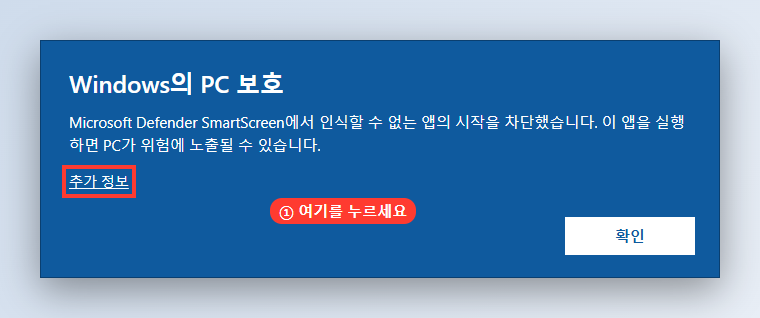
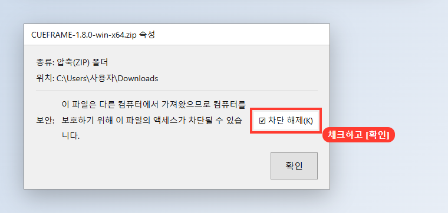
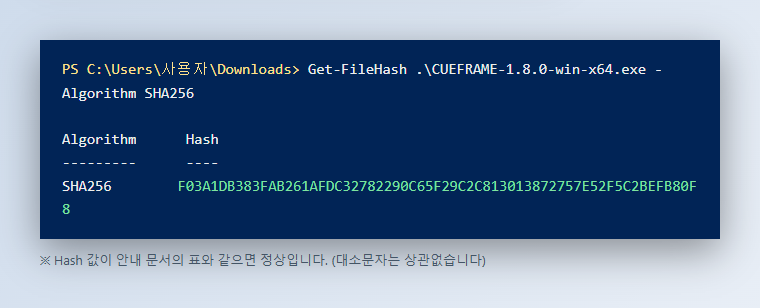
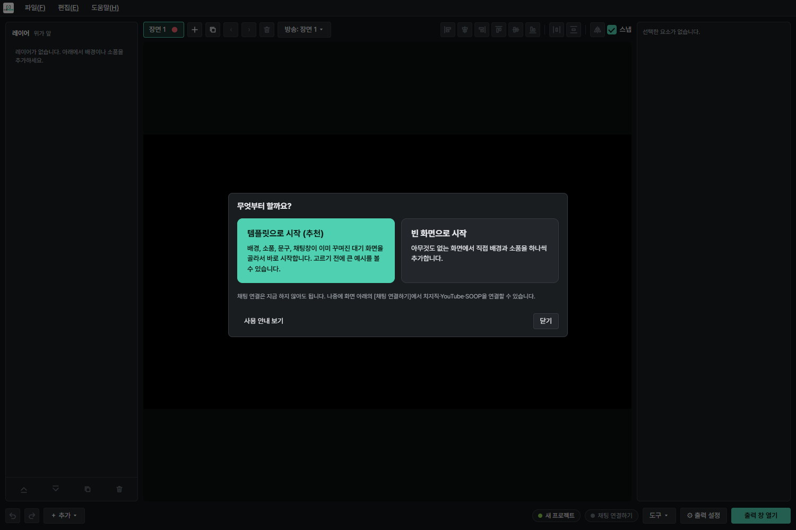
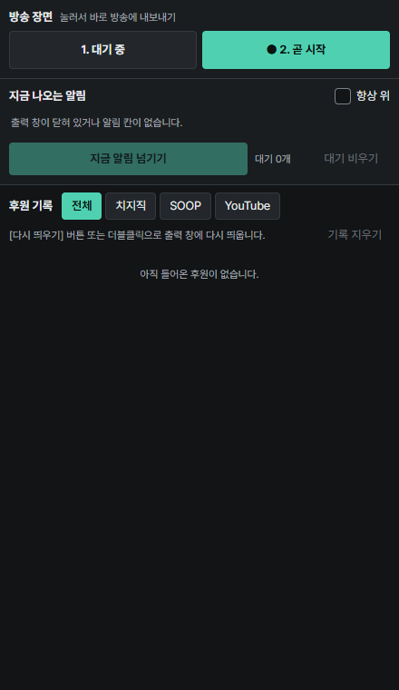

# CUEFRAME 설치 안내

구매해 주셔서 감사합니다. 처음 설치할 때 Windows가 **파란색 경고 화면**을 보여 주는데, 아래 순서대로 하면 설치할 수 있습니다. 5분이면 끝납니다.

---

## 1. 받기

판매자가 알려 준 주소(GitHub 릴리즈 페이지)에서 아래 파일 중 **하나**만 받습니다.

| 파일 | 설명 |
|---|---|
| `CUEFRAME-버전-win-x64.exe` | **설치 파일 (권장)**. 설치 후 시작 메뉴·바탕화면에 아이콘이 생기고, 새 버전이 나오면 알려 줍니다. |
| `CUEFRAME-버전-win-x64.zip` | 설치 없이 압축만 풀어서 쓰는 방식. 위 설치 파일이 막힐 때 대신 쓸 수 있습니다. |
| `CUEFRAME-버전-portable.exe` | **포터블 (설치 없이 실행)**. 파일 하나를 받아 더블클릭하면 실행됩니다. 자동 업데이트는 되지 않으니, 새 버전이 나오면 새 파일로 바꿔 주세요. |

다른 사이트나 메신저로 전달받은 파일은 열지 마시고, **판매자가 알려 준 주소에서만** 받으세요.

> 브라우저(Edge·Chrome)가 "흔히 다운로드되지 않는 파일입니다" 또는 "안전하지 않을 수 있습니다"라고 물으면, 위 주소에서 받은 파일이 맞다면 **[유지]**(Edge는 `…` ▸ `유지` ▸ `그래도 유지`)를 누르세요.

---

## 2. 설치하기 (설치 파일 `.exe`)

1. 받은 `CUEFRAME-…-win-x64.exe`를 더블클릭합니다.
2. **"Windows의 PC 보호"** 파란 창이 뜨면 → 아래 **"3. Windows 경고 넘기기"**를 따라 하세요.
3. 설치 마법사에서 **[다음]** 을 누르고, 설치할 폴더를 확인한 뒤 **[설치]** 를 누릅니다. (관리자 권한은 필요하지 않습니다.)
4. 끝나면 **[마침]**. 바탕화면의 **CUEFRAME** 아이콘으로 실행합니다.

---

## 3. Windows 경고 넘기기

### 어떤 화면인가요?

> **Windows의 PC 보호**
> Microsoft Defender SmartScreen에서 인식할 수 없는 앱의 시작을 차단했습니다. 이 앱을 실행하면 PC가 위험에 노출될 수 있습니다.

### 왜 뜨나요?

- 이 프로그램에는 **디지털 서명**(프로그램 제작자를 Microsoft에 증명하는 유료 인증서)이 없습니다. 개인이 만든 프로그램은 대부분 비용 때문에 서명 없이 배포됩니다.
- 그래서 Windows는 이 프로그램의 **게시자를 "알 수 없음"** 으로 보고, 아직 다운로드한 사람이 많지 않은 프로그램에는 일단 이 경고를 보여 줍니다.
- **바이러스가 발견되었다는 뜻이 아닙니다.** 서명이 없거나 새 프로그램이면 누구에게나 나오는 일반 경고입니다.
- 다만 Windows가 "믿을 수 있는지 모른다"고 하는 것이므로, **판매자에게서 받은 파일이 맞을 때만** 넘어가세요(아래 5번에서 파일이 맞는지 확인하는 방법을 안내합니다).

### 넘기는 방법

> 아래 그림은 이해를 돕기 위한 **예시 화면**입니다. Windows 버전에 따라 모양이 조금 다를 수 있습니다.

1. 경고 창에서 **[추가 정보]** 를 누릅니다. (처음에는 [확인]만 보이고 [추가 정보]는 글자 링크입니다.)

   

2. 아래에 **[실행]** 버튼이 새로 나타납니다. 게시자가 **"알 수 없는 게시자"** 로 보이는 것이 정상입니다.
3. **[실행]** 을 누르면 설치가 시작됩니다.

   ![[실행] 버튼을 누르면 설치가 시작됩니다](images/smartscreen-2.png)

> 설치할 때 한 번 넘기면, 같은 파일에서는 다시 묻지 않습니다. 새 버전으로 업데이트할 때는 같은 경고가 다시 나올 수 있습니다. 같은 방법으로 넘기면 됩니다.

---

## 4. 그래도 안 될 때

### "[실행] 버튼이 안 보여요"
회사·학교 PC이거나 Windows 보안 정책이 강하게 설정된 PC입니다. 개인 PC에서 시도하거나, PC 관리자에게 문의하세요.

### zip 파일로 쓰는 경우 — 압축을 풀었는데 실행이 안 돼요
인터넷에서 받은 zip은 Windows가 "차단됨" 표시를 붙여 둘 수 있습니다.

1. **압축을 풀기 전에** zip 파일을 마우스 오른쪽 클릭 ▸ **속성**
2. 아래쪽 **"보안: 이 파일은 다른 컴퓨터에서 가져온 것이므로…"** 옆의 **[차단 해제]** 체크 ▸ **[확인]**
3. 그 다음에 압축을 풀고, 폴더 안의 `CUEFRAME.exe`를 실행합니다.



### 백신(Defender, V3, 알약 등)이 파일을 지우거나 격리했어요
서명이 없는 새 프로그램은 백신이 의심스럽다고 판단하는 일이 있습니다(오탐).

1. 백신의 **격리/검역 목록**에서 해당 파일을 **복원**하고, **예외(허용) 목록에 추가**합니다.
   - Windows 보안: `바이러스 및 위협 방지` ▸ `보호 기록` ▸ 해당 항목 ▸ `작업` ▸ `허용`
2. 다시 설치합니다.
3. 불안하면 아래 5번으로 **파일이 판매자가 올린 것과 같은지** 먼저 확인하세요.

### 설치는 됐는데 실행하면 바로 꺼져요 / 화면이 안 나와요
- 프로그램을 완전히 종료(작업 관리자에서 `CUEFRAME` 종료)했다가 다시 실행해 보세요.
- 그래도 안 되면 CUEFRAME의 **[도움말] ▸ [로그 내보내기…]**(프로그램이 열리는 경우) 또는 폴더 `%AppData%\StandbyScreen\logs`의 `.log` 파일을 판매자에게 보내 주세요. 로그에는 키·토큰·로그인 정보가 가려진 채로 기록됩니다.

---

## 5. 받은 파일이 맞는지 확인하기 (선택, 권장)

판매자가 올린 파일이 중간에 바뀌지 않았는지 **지문(SHA-256 해시)** 으로 확인할 수 있습니다.

1. 받은 파일이 있는 폴더에서 **Shift + 마우스 오른쪽 클릭** ▸ **"여기에 PowerShell 창 열기"**(또는 "터미널에서 열기")
2. 아래를 입력합니다. (파일 이름은 받은 파일에 맞게 바꾸세요.)

```powershell
Get-FileHash .\CUEFRAME-1.9.4-win-x64.exe -Algorithm SHA256
```

   결과는 이런 모양입니다. (예시 화면)

   

3. 나온 `Hash` 값이 아래 표(또는 판매자가 알려 준 값)와 **완전히 같으면** 올바른 파일입니다. 한 글자라도 다르면 실행하지 말고 판매자에게 문의하세요.

| 버전 | 파일 | SHA-256 |
|---|---|---|
| 1.9.4 | `CUEFRAME-1.9.4-win-x64.exe` | `0f6a3dac25272a3079cb8787e58a78a96a044e0a6e1d2433f98bc165b184de53` |
| 1.9.4 | `CUEFRAME-1.9.4-win-x64.zip` | `eca9173364760027e9eced50471443217c01eddde768e5663d17cc2c34c5d713` |
| 1.9.4 | `CUEFRAME-1.9.4-portable.exe` | `5f762537513f9ba1a940db44a137aa1cd14636975ce5812dc281d5523369ab66` |
| 1.9.3 | `CUEFRAME-1.9.3-win-x64.exe` | `e703f7e6a21b649657374db35ccabd9c68a931e295000f08c00988c2d91fdcdc` |
| 1.9.3 | `CUEFRAME-1.9.3-win-x64.zip` | `d251d81756eee207e01be46d3185d46a14a69cec95f3d1ebc3898cea353a0058` |
| 1.9.3 | `CUEFRAME-1.9.3-portable.exe` | `9d6a36918914a5d8c45d2a382e657d33d8501e6adf0f70b67a49a8e1713db09b` |
| 1.9.2 | `CUEFRAME-1.9.2-win-x64.exe` | `6df1dd89000779fda4fc353808ef4b8597115b6bb2b64af8196cd574c7530359` |
| 1.9.2 | `CUEFRAME-1.9.2-win-x64.zip` | `3824f845bb7793511c5e149f43b8b517c5f706ddfd6be312d54f5ea1cb1f910c` |
| 1.9.2 | `CUEFRAME-1.9.2-portable.exe` | `dae1eeffed8696f1b732ff2783983b2323cb7ca5e67b8813100458b8ec67fe62` |
| 1.9.1 | `CUEFRAME-1.9.1-win-x64.exe` | `6211c224bb3bf0806c463b4792c7410582ff5e7a5b56d20ac9a21d1930812ba5` |
| 1.9.1 | `CUEFRAME-1.9.1-win-x64.zip` | `c7c085d50467d71cbb8b8ee1e87d6f38a25750e3fc4635a45faf3c7fd945656c` |
| 1.9.0 | `CUEFRAME-1.9.0-win-x64.exe` | `e514cd24f2c1192991c8a5f03c692b8dba59910680451b4e1ddf71ec216ab4ac` |
| 1.9.0 | `CUEFRAME-1.9.0-win-x64.zip` | `bbd99a3fd9f5e08d773de4f28d76439632544aa8cfed99070d25f444bc631d62` |
| 1.8.0 | `CUEFRAME-1.8.0-win-x64.exe` | `f03a1db383fab261afdc32782290c65f29c2c813013872757e52f5c2befb80f8` |
| 1.8.0 | `CUEFRAME-1.8.0-win-x64.zip` | `dc45240154302cdc06dabd94dd8df341fee9be52abe72202714b6cfa8a3c6672` |

> 새 버전이 나오면 해시 값도 바뀝니다. 최신 값은 판매자에게 확인하세요.

---

## 6. 처음 실행하면

1. **시작 화면**이 뜹니다. **[템플릿으로 시작]** 을 누르면 완성된 대기화면을 큰 예시로 보고 고를 수 있습니다.

   

2. 채팅 연결은 **나중에** 해도 됩니다. 화면 아래 **[채팅 연결하기]** 에서 치지직·YouTube·SOOP을 연결합니다. 후원 알림을 받으려면 [후원 로그인·연동 안내](후원연동안내.md)를 보세요.
3. 방송 중에는 **방송 리모컨**(도구 ▾ ▸ 방송 리모컨 열기)에서 장면을 바꾸고 후원 알림을 다룰 수 있습니다.

   

4. **[출력 창 열기]** 를 누르고, OBS에서 **창 캡처**로 "방송 출력 창"을 고릅니다. (자세한 방법: **[도움말] ▸ [OBS 설정 안내]**)

---

## 7. 업데이트와 삭제

- **업데이트**: 새 버전이 나오면 프로그램 안에 알림이 뜹니다. 안내에 따라 설치하세요. 만들어 둔 프로젝트는 그대로 남습니다.
- **삭제**: Windows `설정` ▸ `앱` ▸ `설치된 앱`에서 **CUEFRAME** ▸ 제거. (zip으로 쓴 경우 폴더를 지우면 됩니다.)
- **프로젝트 파일**은 직접 고른 폴더에 저장되므로 삭제해도 남습니다. 설정·로그는 `%AppData%\StandbyScreen`, 암호화된 로그인 정보는 `%LocalAppData%\StandbyScreen`에 있어, 완전히 지우려면 이 두 폴더를 지우세요.

---

## 8. 이 프로그램이 인터넷에서 하는 일

- 치지직·YouTube·SOOP에 **채팅을 가져오기 위해** 접속합니다(연결했을 때만).
- 새 버전이 있는지 **업데이트를 확인**합니다(GitHub).
- 로그인 정보와 키는 이 PC 안에 **암호화되어 저장**되며, 판매자나 다른 곳으로 보내지지 않습니다.

---

문의: 판매자에게 연락해 주세요. 문의할 때는 **Windows 버전**, **프로그램 버전**(`[도움말] ▸ [정보]`), 그리고 **화면에 나온 문구나 캡처**를 함께 보내 주시면 빠르게 해결할 수 있습니다.
