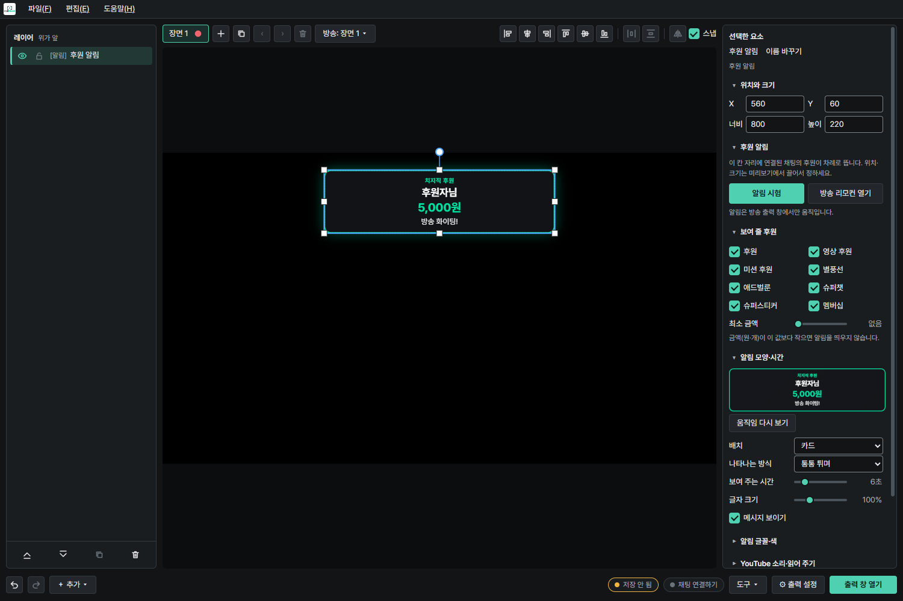
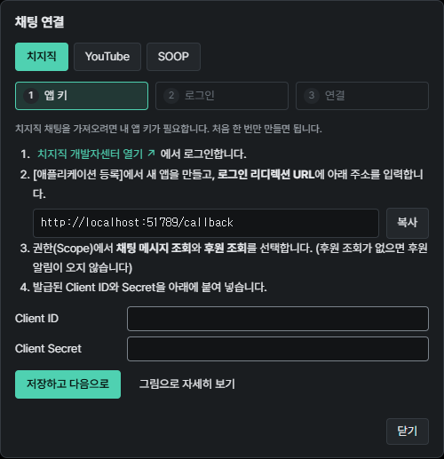
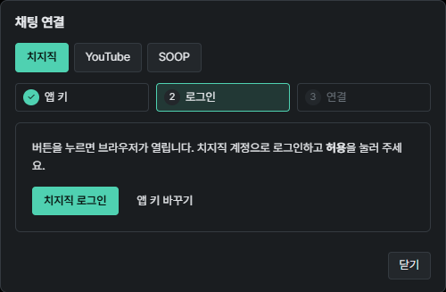
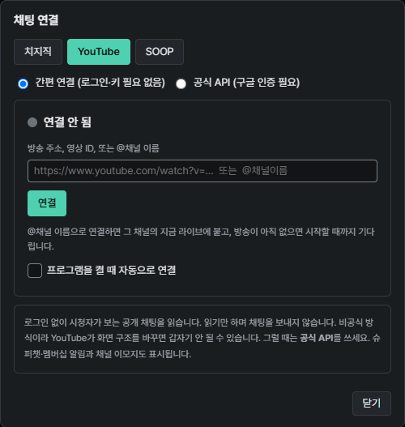
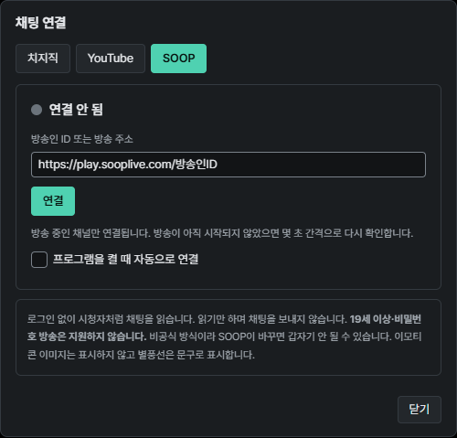
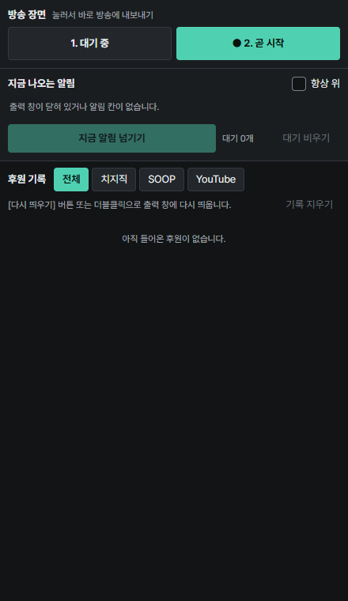

# CUEFRAME 후원 로그인·연동 안내

방송 중 들어오는 후원(치지직 후원·영상 후원, SOOP 별풍선, YouTube 슈퍼챗 등)을 대기화면 위에 알림으로 띄우려면 **채팅 연결**을 먼저 해야 합니다. 후원은 채팅 연결에 딸려 옵니다. 플랫폼마다 필요한 것이 다릅니다.

| 플랫폼 | 필요한 것 | 걸리는 시간 |
|---|---|---|
| **치지직** | 개발자센터에서 앱 만들기(처음 한 번) + 네이버 로그인 | 약 10분 |
| **YouTube (간편)** | 방송 주소 또는 @채널 이름만 (로그인·키 없음) | 1분 |
| **SOOP** | 방송인 ID 또는 방송 주소만 (로그인 없음) | 1분 |

> 아래 그림은 CUEFRAME의 실제 화면입니다. 입력한 값(키, 주소)은 예시입니다. 치지직·구글·SOOP 사이트의 화면은 서비스가 바꿀 수 있어, 그림 대신 글로 안내합니다.

---

## 0. 후원 알림 칸 놓기 (공통)

연결과 별개로, 후원이 **화면 어디에 뜰지** 칸을 하나 놓아야 합니다.

1. 왼쪽 아래 **[＋ 추가]** ▸ **[후원 알림 칸]**
2. 미리보기에서 칸을 끌어 위치와 크기를 정합니다.
3. 오른쪽 설정에서 보여 줄 후원 종류, 최소 금액, 모양, 시간을 고릅니다.
4. **[알림 시험]** 을 눌러 어떻게 보이는지 확인합니다. (알림은 **방송 출력 창**에서만 움직입니다. [출력 창 열기]를 먼저 눌러 두세요.)



---

## 1. 치지직 연결 (후원 포함)

치지직은 **내가 직접 앱 키를 만들어야** 합니다(처음 한 번). 만든 키는 이 PC에만 암호화되어 저장됩니다.

### 1-1. 치지직 개발자센터에서 앱 만들기

1. 화면 아래 **[채팅 연결하기]** 를 누르고, 위쪽 **[치지직]** 탭을 엽니다.
2. **[치지직 개발자센터 열기 ↗]** 를 누르면 브라우저에 개발자센터가 열립니다. 네이버 계정으로 로그인합니다.
3. **[애플리케이션 등록]** 으로 새 앱을 만듭니다. 앱 이름은 자유롭게 정합니다.
4. **로그인 리디렉션 URL** 칸에 아래 주소를 **정확히** 넣습니다. CUEFRAME 창의 **[복사]** 버튼으로 복사해서 붙여 넣으면 틀리지 않습니다.

   ```
   http://localhost:51789/callback
   ```

5. **API 권한(Scope)** 에서 아래 **두 가지를 모두** 선택합니다.
   - **채팅 메시지 조회**
   - **후원 조회** ← 이것이 없으면 채팅은 보여도 **후원 알림이 오지 않습니다**
6. 등록이 끝나면 **Client ID** 와 **Client Secret** 이 나옵니다. Client Secret은 다른 사람에게 보여 주지 마세요.



### 1-2. CUEFRAME에 키 넣기

1. 위 그림의 **Client ID**, **Client Secret** 칸에 붙여 넣고 **[저장하고 다음으로]** 를 누릅니다.

### 1-3. 로그인하고 연결

1. **[치지직 로그인]** 을 누르면 브라우저가 열립니다.
2. 네이버 계정으로 로그인하고 **[허용]** 을 누릅니다. 자동으로 CUEFRAME으로 돌아옵니다.
3. 상태가 **"연결됨"** 으로 바뀌면 끝입니다. 처음이 아니라면 **[채팅 연결]** 만 누르면 됩니다.



> **"연결됨 (후원 알림 권한 없음)"** 이라고 나오면: 1-1의 5번에서 **후원 조회**를 선택하지 않은 것입니다. 개발자센터의 내 애플리케이션에서 **후원 조회** 권한을 켠 뒤 치지직을 **다시 연결**하세요. 채팅은 그대로 보입니다.

> **방송 주소가 아닌 "내 채널"에 연결됩니다.** 로그인한 네이버 계정의 치지직 채널 채팅·후원을 받습니다. 방송하는 계정으로 로그인하세요.

---

## 2. YouTube 연결 (슈퍼챗·슈퍼스티커·멤버십)

**[YouTube]** 탭을 엽니다. 두 가지 방식이 있습니다.

### 방법 A. 간편 연결 (권장, 로그인·키 필요 없음)

1. **[간편 연결]** 이 선택된 상태에서, 칸에 아래 중 하나를 넣습니다.
   - 방송 주소 (`https://www.youtube.com/watch?v=...`)
   - 영상 ID
   - `@채널이름` (방송이 시작될 때까지 기다렸다가 자동으로 붙습니다)
2. **[연결]** 을 누릅니다. 연결되면 슈퍼챗·슈퍼스티커·멤버십 알림이 뜹니다.
3. 매번 쓰는 채널이면 **[프로그램을 켤 때 자동으로 연결]** 을 켜 두세요.



> 간편 연결은 시청자가 보는 공개 채팅을 읽는 **비공식 방식**입니다. YouTube가 화면 구조를 바꾸면 예고 없이 안 될 수 있습니다. 방송에서 꼭 필요하다면 **공식 API**를 쓰세요.

### 방법 B. 공식 API (구글 인증 필요)

간편 연결이 막혔을 때의 대비책입니다. 구글 클라우드에서 한 번 설정해야 합니다.

1. **[공식 API]** 를 고르고 **[Google Cloud 콘솔 열기 ↗]** 로 로그인한 뒤 **새 프로젝트**를 만듭니다.
2. **API 및 서비스 ▸ 라이브러리**에서 **YouTube Data API v3** 를 **사용**으로 켭니다.
3. **OAuth 동의 화면**을 **외부**로 만들고 **게시 상태를 "프로덕션"** 으로 바꿉니다. (테스트 상태로 두면 7일마다 다시 로그인해야 합니다)
4. **사용자 인증 정보 ▸ OAuth 클라이언트 ID 만들기**에서 종류를 **데스크톱 앱**으로 고릅니다.
5. 만들어진 **클라이언트 ID**, **보안 비밀**을 CUEFRAME에 붙여 넣고 **[YouTube 로그인]** ▸ 구글 계정으로 허용합니다.

공식 API는 구글이 정한 하루 사용량(기본 10,000 단위)을 쓰고, 연결 창에서 사용량을 볼 수 있습니다.

### YouTube 후원 소리·읽어 주기

치지직·SOOP은 각 사이트 위젯의 소리를 쓰므로, **YouTube 후원에만** 효과음과 읽어 주기(TTS)가 적용됩니다. 후원 알림 칸 설정의 **[YouTube 소리·읽어 주기]** 에서 켭니다.

---

## 3. SOOP 연결 (별풍선·영상풍선·애드벌룬)

**[SOOP]** 탭을 엽니다. 로그인은 필요 없습니다.

1. 칸에 **방송인 ID** 또는 **방송 주소**(`https://play.sooplive.com/방송인ID`)를 넣습니다.
2. **[연결]** 을 누릅니다.
3. 방송 중인 채널에만 연결됩니다. 아직 방송을 시작하지 않았다면 몇 초 간격으로 다시 확인합니다.



> SOOP도 **비공식 방식**입니다. 19세 이상·비밀번호 방송은 지원하지 않고, SOOP이 방식을 바꾸면 안 될 수 있습니다. 별풍선은 **문구로 표시**됩니다.

---

## 4. 연결됐는지 확인하기

1. 화면 오른쪽 아래 채팅 상태 칩이 **"연결됨"** 인지 봅니다. (연결 전에는 "채팅 연결하기")
2. 채팅창 요소에 실제 채팅이 나오는지 봅니다.
3. 후원 알림 칸에서 **[알림 시험]** 으로 모양을 확인합니다. (이건 연결 확인이 아니라 모양 확인입니다.)
4. 방송 중에는 **[도구 ▾] ▸ [방송 리모컨 열기]** 의 후원 기록에 실제 후원이 쌓이는지 봅니다. 기록의 **[다시 띄우기]** 로 알림을 다시 띄울 수도 있습니다.



여러 플랫폼을 **동시에** 연결할 수 있고, 채팅과 후원은 한 곳에 섞여 나옵니다.

---

## 5. 안 될 때

| 증상 | 확인할 것 |
|---|---|
| 채팅은 나오는데 **치지직 후원이 안 뜸** | "후원 조회" 권한을 켰는지(1-1의 5번). 켠 뒤 **다시 연결**해야 합니다. |
| "채팅 조회 권한이 없습니다" | 앱 권한에 "채팅 메시지 조회"가 있는지. |
| 치지직 로그인 후 돌아오지 않음 | 리디렉션 URL이 `http://localhost:51789/callback` 와 **한 글자도 다르지 않은지**. 다른 프로그램이 51789번 포트를 쓰고 있지 않은지. |
| YouTube / SOOP이 갑자기 안 됨 | 비공식 방식이라 사이트가 바뀌었을 수 있습니다. YouTube는 공식 API로 바꿔 보세요. 프로그램 업데이트도 확인하세요. |
| SOOP이 연결 안 됨 | 방송 중인지, 19세 이상·비밀번호 방송이 아닌지. |
| 알림이 안 보임 | 알림은 **방송 출력 창에서만** 움직입니다. [출력 창 열기] 후 확인하세요. 연결 직후에 딸려 오는 **30초 넘은 지난 후원은 띄우지 않습니다.** |
| 후원이 이상하게 보임 | 후원 알림 칸 설정의 **[후원 기록·문제 확인] ▸ [받은 후원 원본을 로그로 남기기]** 를 켜고 다시 받아 보세요. 원본이 `%AppData%\StandbyScreen\logs\donation-raw.txt` 에 쌓입니다. 닉네임·후원 내용이 들어 있으므로 판매자에게 보낼 때 유의하세요. |

## 6. 안전하게 쓰기

- 연결은 **모두 읽기 전용**입니다. 채팅을 보내거나 방송 설정을 바꾸지 않습니다.
- Client Secret, 로그인 정보는 이 PC에 **암호화되어 저장**되며 다른 곳으로 보내지지 않습니다. 화면 캡처나 방송에 **Client Secret을 보여 주지 마세요.**
- 연결을 끊거나 지우려면 연결 창의 **[연결 끊기]**, **[로그아웃]** 을 누르세요.
- 후원 기록은 이 PC(`%AppData%\StandbyScreen\donations`)에 저장됩니다. 리모컨의 **[기록 지우기]** 로 지울 수 있고, CSV로 내보낼 수도 있습니다.
